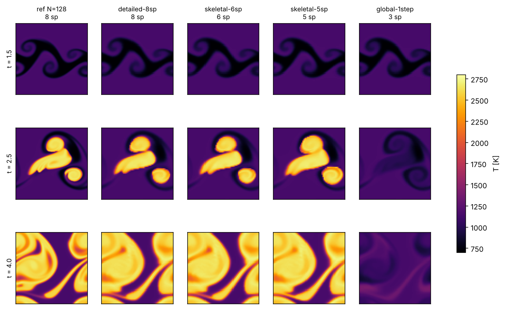
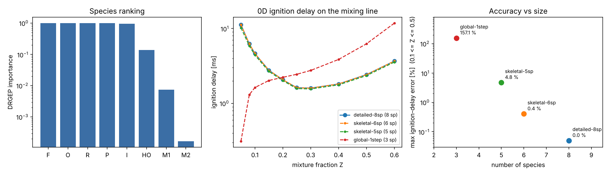
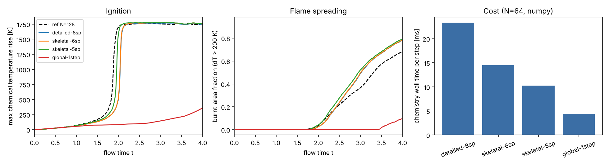

# les-kinetic-reduction-lab

**How much chemistry does a reacting-flow LES need?**
A small, fully self-contained teaching project that takes a chain-branching kinetic mechanism from *detailed* to *skeletal* to *global*, and shows what each reduction level costs in accuracy and saves in CPU time inside a 2D large-eddy simulation of an auto-igniting jet.

Pure Python (NumPy / SciPy / Matplotlib). No CFD package, no Cantera. The full study runs in about **3 minutes** on a laptop, so it fits in a lab session.


*Temperature in a temporally evolving planar jet (cold fuel core, hot oxidiser co-flow) with four kinetic mechanisms. Left column: finer-grid reference (N=128). Other columns: N=64 with the detailed, 6-species, 5-species and one-step mechanisms.*

---

## What is in the box

| Step | What it does | Script |
|---|---|---|
| 1. Reduction (0D) | DRGEP species ranking, skeletal mechanisms, a fitted global one-step mechanism, ignition-delay validation | `examples/01_reduction_0d.py` |
| 2. LES (2D) | Pseudo-spectral LES + finite-rate chemistry with each mechanism; ignition time, kernel location, flame spreading, cost | `examples/02_les_jet.py` |

Supporting code lives in `src/lesreduce/`: `kinetics.py` (mechanism class, analytic Jacobian, DRGEP, ignition delay, global fit), `les2d.py` (the solver), `levels.py` (builds the four mechanism levels). Student-facing instructions are in [`docs/lab_handout.md`](docs/lab_handout.md).

## Quick start

```bash
pip install -r requirements.txt
python examples/01_reduction_0d.py        # ~45 s first time (the one-step fit takes ~30 s and is cached), ~15 s after
python examples/02_les_jet.py             # ~2 min: N=64, four mechanisms
pytest -q                                 # ~10 s
```

Optional fine-grid reference (about 6 minutes) and a coarser grid for the grid-sensitivity row:

```bash
python examples/02_les_jet.py --N 128 --mechs detailed-8sp
python examples/02_les_jet.py --N 48  --mechs detailed-8sp
python examples/02_les_jet.py --summary-only      # rebuild tables and figures from cached runs
```

Results from the runs described below are committed in `results/` and `figures/`.

## Results

### 1. Mechanism reduction in 0D

The toy mechanism has 8 species and 12 reactions: chain initiation, branching and termination (which gives an "explosion limit" crossover in temperature), a delayed HO channel, and two minor side channels. DRGEP ranks the minor species lowest (M2 ≈ 2e-4, M1 ≈ 7e-3, HO ≈ 0.14, all others ≥ 0.96), and thresholding that ranking gives the skeletal mechanisms.

| Mechanism | Species | Reactions | Max τ error | Mean τ error |
|---|---:|---:|---:|---:|
| Detailed | 8 | 12 | – | – |
| DRGEP skeletal (ε = 0.01) | 6 | 8 | 0.4 % | 0.2 % |
| DRGEP skeletal (ε = 0.3) | 5 | 5 | 4.8 % | 3.3 % |
| Global one-step (fitted) | 3 | 1 | 157 % | 70 % |

Ignition-delay error τ along the mixing line, for 0.1 ≤ Z ≤ 0.5. The one-step mechanism was fitted to the detailed τ over Z = 0.1–0.4 (for a one-step Arrhenius law τ ∝ 1/A exactly, so A is solved analytically and only Eₐ is scanned).



The one-step mechanism fails structurally, not just numerically: the detailed mechanism has a minimum ignition delay at intermediate Z (more fuel means more radical production and heat release, but the mixture is also colder), while the fitted one-step law gives a τ that rises with Z over the whole range.

### 2. LES with each mechanism

Same flow, same initial perturbation, same grid. Only the kinetics change.

| Case | N | Species | Ignition time | Ignition Z | Burnt area at t=3 | Chem. cost / step | Chem. speed-up | Δ ignition time vs N=64 detailed |
|---|---:|---:|---:|---:|---:|---:|---:|---:|
| Reference (detailed) | 128 | 8 | 1.59 | 0.34 | 0.37 | 89 ms | – | – |
| Detailed | 64 | 8 | 1.74 | 0.41 | 0.49 | 23.3 ms | 1.0× | – |
| Skeletal 6 sp | 64 | 6 | 1.74 | 0.41 | 0.50 | 14.5 ms | 1.6× | 0.0 % |
| Skeletal 5 sp | 64 | 5 | 1.68 | 0.41 | 0.52 | 10.3 ms | 2.3× | −3.2 % |
| Global one-step | 64 | 3 | 3.40 | 0.26 | 0.00 | 4.4 ms | 5.3× | +96 % |
| Detailed (coarser) | 48 | 8 | 1.83 | 0.42 | 0.53 | 13.1 ms | – | +5.4 % |

Ignition time is in flow time units (1 unit = 1 ms in the chemistry); "ignition" is the first time the maximum chemical temperature rise exceeds 200 K. "Burnt area" is the fraction of the domain with a chemical temperature rise above 200 K.



What the numbers say:

* **Skeletal 6 sp is free.** Ignition time and flame spreading are indistinguishable from the detailed mechanism, at 1.6× lower chemistry cost.
* **Skeletal 5 sp trades 3 % in ignition time for 2.3× cost.** That error is smaller than the *grid* error.
* **Grid error is larger than the reduction error.** Against the N=128 reference, the N=64 detailed run is 9.5 % late and N=48 is 15 % late. Refining the grid would improve the answer more than keeping the extra species.
* **The one-step mechanism ignites about twice as late, in leaner mixture (Z ≈ 0.26 vs 0.41), and is far behind afterwards:** at t=4 it has burnt 10 % of the domain against 78 % for the detailed mechanism, and at t=5 its mean chemical temperature rise is 225 K against 1379 K. Being tuned to the 0D ignition delay does not make it right in a flow, because the flow sets the mixture history.
* **The ignition kernel sits at Z ≈ 0.41, not at the 0D most-reactive Z ≈ 0.3,** at N=64 (0.34 at N=128). Diffusion and strain in the flow shift where ignition happens.
* **The sub-grid model matters at the same level as chemistry choices.** With the detailed mechanism at N=48, switching the Smagorinsky model off (Cs = 0) moves ignition from 1.83 to 1.90 (about 4 %).

## The model

**Flow.** Incompressible 2D Navier–Stokes in a doubly periodic unit box, Fourier pseudo-spectral with 2/3 de-aliasing, Smagorinsky sub-grid viscosity (C_s = 0.17, Δ = grid spacing), SSP-RK3. Initial condition: a planar jet (tanh profiles, width 0.25, shear-layer thickness 0.025) with a small divergence-free perturbation built from a stream function; the perturbation is identical at every resolution.

**Scalars.** Mixture fraction Z, chemical temperature rise H, and species concentrations, advected with a MUSCL/van Leer TVD finite-volume scheme and diffused with ν/Sc + ν_t/Sc_t (Sc = 0.7, Sc_t = 0.9). Temperature is T = T_mix(Z) + H with T_mix running from 700 K (fuel) to 1150 K (oxidiser).

**Chemistry.** Mass-action kinetics with Arrhenius rates, Strang-split from transport, integrated with a linearly-implicit Euler method using the analytic Jacobian, vectorised over all cells. Cells where fuel and oxidiser do not coexist and no intermediates are present are skipped (this reproduces the all-cell result to 1e-3 K and saves ~20 % in a test to t = 2.6). The step is first order; a test checks that it reproduces the 0D BDF ignition delay to within 5 % at the LES time step.

**Reduction.** DRGEP (Pepiot-Desjardins & Pitsch, 2008): direct interaction coefficients from sampled 0D ignition trajectories, path-dependent error propagation by max-product Dijkstra search from the targets F, O and P, thresholding on the resulting importance.

## Limitations (please read before drawing conclusions)

* **The mechanism is a toy, not a real fuel.** Species, rate parameters and heat release were chosen to give a chain-branching crossover and millisecond ignition delays. There is no thermochemistry database and no validation against experiments.
* **Constant density, one-way coupling.** There is no dilatation or buoyancy, so heat release does not feed back on the flow. This isolates kinetics effects but is not a real flame. Reynolds number is a free parameter and is not matched to a physical jet.
* **2D.** There is no vortex stretching and the energy cascade is inverse, so Smagorinsky is a numerical regulariser here rather than a physically justified sub-grid model. A 3D extension would be the natural next step.
* **No turbulence–chemistry interaction model.** Chemistry is evaluated on the resolved (filtered) state ("laminar chemistry"). PaSR/EDC-style closures are a suggested exercise.
* **One flow realisation, one grid sequence.** The reference at N=128 is a finer-grid LES with the same model, not a DNS and not grid-converged. The percentages above are for this case and would change with the perturbation seed.
* **Timings are for vectorised NumPy.** Cost scales mostly with the number of reactions evaluated in Python loops. The speed-ups are indicative of the trend, not of what a compiled stiff-ODE code would show, where cost typically grows faster with species count.

## Roadmap (not implemented)

* Swap the toy mechanism for a real NH₃/H₂ mechanism via Cantera, and run the same DRGEP workflow on it.
* Add data-driven reduction (PCA of the 0D data, learned species lumping) next to DRGEP.
* Add a simple discharge source term (radical or energy deposition) to the 0D ignition problem and to a spark region in the LES, to study how reduction interacts with non-equilibrium chemistry.
* 3D LES and a PaSR closure.

## References

* Pepiot-Desjardins, P., Pitsch, H. (2008). An efficient error-propagation-based reduction method for large chemical kinetic mechanisms. *Combust. Flame* 154, 67–81.
* Lu, T., Law, C. K. (2005). A directed relation graph method for mechanism reduction. *Proc. Combust. Inst.* 30, 1333–1341.
* Smagorinsky, J. (1963). General circulation experiments with the primitive equations. *Mon. Weather Rev.* 91, 99–164.
* van Leer, B. (1979). Towards the ultimate conservative difference scheme V. *J. Comput. Phys.* 32, 101–136.
* Gottlieb, S., Shu, C.-W. (1998). Total variation diminishing Runge–Kutta schemes. *Math. Comp.* 67, 73–85.

## License

MIT, see [LICENSE](LICENSE).
